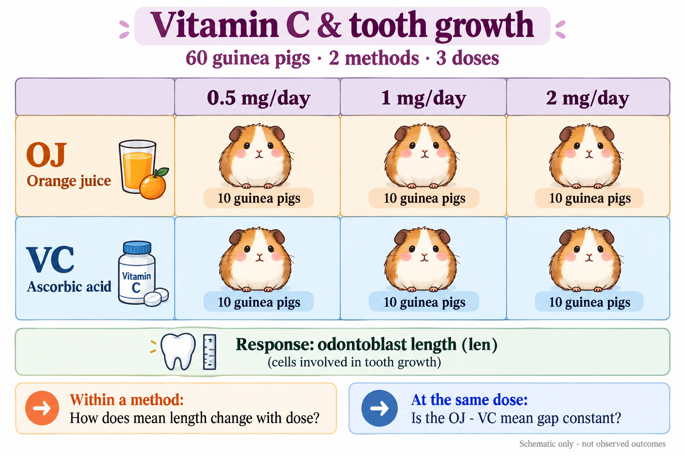

# Multiple Regression and Categorical Predictors {#sec-multiple-regression}

[Chapter 4](04.qmd) compared models. Here we learn to **build and interpret** them when predictors include groups and interactions.

> **Learning Objectives**
>
> By the end of this chapter, students should be able to:
>
> - compare unadjusted and adjusted associations;
> - code a factor and count its design-matrix columns;
> - interpret additive and interaction models;
> - explain how centering and reference groups affect coefficient meanings;
> - choose a model comparison for a scientific question and check it in R.

**Reading.** Multiple regression, qualitative predictors, and interactions in Montgomery, Peck, and Vining [@montgomery:2021:book] and Seber and Lee [@seber:2003:book].

::: {.callout-note title="Recap of the Linear Model"}

[Chapter 1](01_matrix_representation.qmd), [Chapter 2](02_LSE.qmd#sec-lse), and [Chapter 3](03_OLS_inference.qmd) gave us the [design-matrix notation](01_matrix_representation.qmd) and [least-squares estimator](02_LSE.qmd#sec-lse). For a full-column-rank design,

$$
\mathbf Y=\mathbf X\boldsymbol\beta+\boldsymbol\varepsilon,
\qquad
\hat{\boldsymbol\beta}=(\mathbf X^\top\mathbf X)^{-1}\mathbf X^\top\mathbf Y.
$$

The fitted means are $\hat{\mathbf Y}=\mathbf X\hat{\boldsymbol\beta}$. Under the [normal-model assumptions](03_OLS_inference.qmd#def-normal-linear-model), [Chapter 4's partial F test](04.qmd#thm-partial-f) compares nested mean models. We now use these tools to interpret the columns and coefficients: **which mean responses are being compared, and what is held fixed?** An adjusted association alone does not establish causation.

:::

::: {.callout-note title="Motivation: what comparison does a coefficient describe?"}

**Trees.** [Chapter 4](04.qmd#exm-timber-volume) asked whether height adds information about timber volume beyond diameter. Now compare two trees of the same diameter: what mean-volume difference corresponds to one extra foot of height? Why might that answer differ from a regression using height alone?

**Vitamin C.** At the same dose, how does mean odontoblast length differ between orange juice and ascorbic acid? Could that difference change with dose?

These questions lead from adjusted slopes to group indicators and interactions. We will write the mean model first, then read the corresponding coefficient or combination of coefficients.

:::

## Multiple regression and adjusted interpretation {#sec-ch5-adjusted}

[Chapter 4](04.qmd#def-regression-parameter-meaning) used an additive model with two predictors. We now make the word **additive** explicit and connect the mean function to the matrix notation from [Chapter 1](01_matrix_representation.qmd#the-linear-regression-model) and [Chapter 2](02_LSE.qmd#sec-lse).

::: {#def-ch5-additive-linear-mean}

## Additive Linear Mean Model

At predictor values $(x_1,\ldots,x_k)$, let $\mu(x_1,\ldots,x_k)$ denote the **mean response** at that predictor profile. An additive linear mean model specifies

$$
\mu(x_1,\ldots,x_k)=\beta_0+\beta_1x_1+\cdots+\beta_kx_k.
$$

**Additive** means that the intercept and the separate predictor contributions are added together. There are no interaction terms, such as $\beta_{12}x_1x_2$: the contribution associated with changing one predictor does not depend on the values of the others. **Linear** means that each contribution here has the form $\beta_jx_j$.

:::

::: {.callout-note title="Additivity concerns the mean function"}

Predictors may be correlated; additivity does **not** require their independence. More generally, a mean of the form $\beta_0+\sum_j f_j(x_j)$ is additive even when the separate functions are curved. Here we use $f_j(x_j)=\beta_jx_j$. An interaction term couples predictors and changes this additive structure; [Section 5.4](#sec-ch5-interaction) develops that extension.

:::

**Connection with the earlier notation.** As in [Chapter 1](01_matrix_representation.qmd#the-linear-regression-model) and [Chapter 2](02_LSE.qmd#sec-lse), first treat predictor values as fixed. For observation $i$, write $\mu_i=\mu(x_{i1},\ldots,x_{ik})$ and

$$
Y_i=\mu_i+\varepsilon_i,
\qquad
\mu_i=\beta_0+\sum_{j=1}^k\beta_jx_{ij}
=\mathbf x_i^\top\boldsymbol\beta,
\qquad \mathbb E(\varepsilon_i)=0.
$$

Following [Chapter 2](02_LSE.qmd), $\mathbf x_i=(1,x_{i1},\ldots,x_{ik})$ is the **column vector including the intercept entry**. Its transpose $\mathbf x_i^\top=(1\;x_{i1}\;\cdots\;x_{ik})$ is row $i$ of the design matrix. Thus $\mu_i$ is the systematic mean part, while $\varepsilon_i$ is the individual deviation from it.

**Design matrix and parameter count.** Stacking these rows gives the familiar matrix form:

$$
\mathbf X=
\begin{pmatrix}
1&x_{11}&\cdots&x_{1k}\\
\vdots&\vdots&&\vdots\\
1&x_{n1}&\cdots&x_{nk}
\end{pmatrix}
\in\mathbb R^{n\times(k+1)},
\qquad
\boldsymbol\beta=(\beta_0,\beta_1,\ldots,\beta_k),
\qquad p=k+1.
$$

The mean vector is $\boldsymbol\mu=(\mu_1,\ldots,\mu_n)=\mathbb E(\mathbf Y)=\mathbf X\boldsymbol\beta$, so $\mathbf Y=\boldsymbol\mu+\boldsymbol\varepsilon=\mathbf X\boldsymbol\beta+\boldsymbol\varepsilon$. This is the same model as before, now written to show what each mean contains. If predictors are random, use the conditional statements $\mathbb E(\mathbf Y\mid\mathbf X)=\mathbf X\boldsymbol\beta$ and $\mathbb E(\boldsymbol\varepsilon\mid\mathbf X)=\mathbf0$.

We assume full column rank, so $\operatorname{rank}(\mathbf X)=p$. Here $k$ counts **predictor columns**, not necessarily named variables: a factor can contribute several indicator columns. The tree model below has height and diameter, giving $k=2$ and $p=3$. Later, adding interaction columns preserves the matrix form but changes the additive mean structure.

::: {#def-ch5-adjusted-coefficient}

## Adjusted Regression Coefficient

In the additive linear mean model of @def-ch5-additive-linear-mean, choose $j\in\{1,\ldots,k\}$. Then $\beta_j$ is the mean-response difference for a one-unit increase in $x_j$, **holding the other predictors fixed**:

$$
\mu(x_1,\ldots,x_j+1,\ldots,x_k)
-\mu(x_1,\ldots,x_j,\ldots,x_k)=\beta_j.
$$

**Why does the difference equal the coefficient?** With the other predictors fixed, $C_j=\beta_0+\sum_{\ell\ne j}\beta_\ell x_\ell$ is the same in both means. Thus the one-unit mean difference is

$$
\Delta_j
=\bigl[C_j+\beta_j(x_j+1)\bigr]
 -\bigl[C_j+\beta_jx_j\bigr]
=\beta_j.
$$

The intercept and all unchanged predictor contributions cancel, leaving $\beta_j[(x_j+1)-x_j]=\beta_j$. A change of $h$ units gives the mean difference $h\beta_j$ in this additive model.

The intercept is the mean when $x_1=\cdots=x_k=0$; see [Chapter 4's coefficient interpretation](04.qmd#def-regression-parameter-meaning).

:::


::: {#exm-ch5-tree-adjustment}

## The Same Height Measurement, Two Comparisons

Return to the [31 black cherry trees](04.qmd#exm-timber-volume). Compare the height coefficient with and without adjustment for diameter. As before, `Girth` records diameter in inches; `Height` is in feet and `Volume` in cubic feet.

```{r}
#| label: ch5-tree-models
library(ggplot2)
theme_set(theme_minimal(base_size = 11) +
            theme(legend.position = "bottom",
              panel.grid.minor = element_blank()))
ch5_trees <- transform(datasets::trees, Diameter = Girth)
ch5_tree_simple <- lm(Volume ~ Height, data = ch5_trees)
ch5_tree_adjusted <- lm(Volume ~ Height + Diameter, data = ch5_trees)
knitr::kable(data.frame(
  Model = c("Height alone", "Height adjusted for diameter"),
  Height_coefficient = c(coef(ch5_tree_simple)["Height"],
                         coef(ch5_tree_adjusted)["Height"])),
  digits = 3, col.names = c("Model", "Height coefficient"),
  row.names = FALSE, align = "c")
```

The height-only slope is **1.543** cubic feet per foot. After adjustment, it is **0.339**: among trees of the same diameter, a one-foot height difference corresponds to 0.339 more cubic feet of fitted mean volume.

```{r}
#| label: fig-ch5-adjustment
#| echo: false
#| fig-pos: "H"
#| fig-cap: "Dashed: height-only fit. Solid: adjusted mean at diameter 13 inches. Color shows observed diameter; distances to the solid line are not residuals because the trees have different diameters."
#| fig-alt: "Timber volume against height, with tree diameter encoded by color. A steep dashed unadjusted line has slope 1.543; a shallower solid line at diameter 13 inches has slope 0.339. Both line meanings appear in the legend."
#| fig-width: 7
#| fig-height: 4.8
ch5_height_grid <- data.frame(
  Height = seq(min(ch5_trees$Height), max(ch5_trees$Height), length.out = 100),
  Diameter = 13)
ch5_height_lines <- rbind(
  transform(ch5_height_grid,
    Volume = predict(ch5_tree_simple, ch5_height_grid),
    Comparison = "Height alone (slope 1.543)"),
  transform(ch5_height_grid,
    Volume = predict(ch5_tree_adjusted, ch5_height_grid),
    Comparison = "At diameter 13 in (slope 0.339)"))
ggplot(ch5_trees, aes(Height, Volume)) +
  geom_point(aes(colour = Diameter), size = 2.7, alpha = 0.9) +
  geom_line(data = ch5_height_lines,
    aes(linetype = Comparison), colour = "#333333", linewidth = 0.9) +
  scale_colour_viridis_c(option = "D", end = 0.85) +
  scale_linetype_manual(values = c(
    "Height alone (slope 1.543)" = "dashed",
    "At diameter 13 in (slope 0.339)" = "solid")) +
  labs(x = "Height (ft)", y = "Timber volume (cubic ft)",
       colour = "Diameter (in)", linetype = NULL) +
  guides(colour = guide_colourbar(order = 1),
         linetype = guide_legend(order = 2, ncol = 1)) +
  theme(legend.box = "vertical")
```

Taller trees in this sample also tend to have larger diameters. The height-only slope includes that accompanying variation; the adjusted slope compares heights at fixed diameter. The two slopes answer different questions.

:::

::: {#exr-ch5-adjusted-interpretation}

## Interpret 0.339

Which interpretation matches the adjusted height coefficient?

A. Increasing any tree's height by one foot causes its volume to increase by 0.339 cubic feet.

B. At the same diameter, a one-foot height difference corresponds to a 0.339-cubic-foot difference in fitted mean volume.

C. Every tree one foot taller has exactly 0.339 more cubic feet of observed volume.

:::

::: {#sol-ch5-adjusted-interpretation}

**B.** The coefficient describes an adjusted mean association. It is neither an automatic causal effect nor an exact difference between individual responses.

:::

## Categorical predictors are columns of a design matrix {#sec-ch5-factor-coding}

**Start with three treatment methods named A, B, and C.** These are names for different methods, not amounts of a treatment. Calling a method B does not mean that it lies halfway between methods A and C.

**Why not enter 1, 2, and 3 as one numeric predictor?** Suppose we store A as $s=1$, B as $s=2$, and C as $s=3$, then fit $\mathbb E(Y\mid s)=\alpha+\gamma s$. Writing $\mu_A,\mu_B,\mu_C$ for the group means, the model requires

$$
\mu_A=\alpha+\gamma,\qquad
\mu_B=\alpha+2\gamma,\qquad
\mu_C=\alpha+3\gamma.
$$

Both A-to-B and B-to-C increase the score by one, so **both changes in the mean must equal the same slope**:

$$
\mu_B-\mu_A=\gamma=\mu_C-\mu_B.
$$

For example, means of 18, 22, and 19 give successive differences of $+4$ and $-3$. The one-slope model cannot represent that mean pattern exactly. The equal-gap restriction comes from treating the arbitrary codes as a numeric predictor; it does not follow from having three groups.

**Use a factor when each group should have its own mean.** In R, `y ~ factor(group)` treats group values as categories, even if they are stored as the numbers 1, 2, and 3. With an intercept and two indicators, the model can represent any three group means, including 18, 22, and 19. The indicator coefficients below show how.

If the groups instead correspond to measured doses, such as 0.5, 1, and 2 mg/day, the numbers have a quantitative meaning. A numeric-dose model still assumes a particular response shape, such as a straight line; a factor-dose model allows separate means at those observed doses. See [Section 5.3](#sec-ch5-additive) and [Section 5.5](#sec-ch5-comparisons).

::: {#def-ch5-treatment-coding}

## Reference-Group Indicator Coding

Let $G_i$ be the group of observation $i$. Suppose A, B, and C are all possible groups and every observation belongs to exactly one of them. With A as the **reference group**, define

$$
D_{Bi}=\mathbb 1\{G_i=\mathrm B\},
\qquad
D_{Ci}=\mathbb 1\{G_i=\mathrm C\},
$$

where an indicator is 1 when its stated condition holds and 0 otherwise. The mean model is

$$
\mathbb E(Y_i\mid G_i)=\beta_0+\beta_BD_{Bi}+\beta_CD_{Ci}.
$$

```{=latex}
\noindent\begin{minipage}{\linewidth}
```

The row of the design matrix is $(1\;D_{Bi}\;D_{Ci})$:

| Group | Intercept column | $D_{Bi}$ | $D_{Ci}$ | Mean |
|:---:|:---:|:---:|:---:|:---:|
| A | 1 | 0 | 0 | $\beta_0$ |
| B | 1 | 1 | 0 | $\beta_0+\beta_B$ |
| C | 1 | 0 | 1 | $\beta_0+\beta_C$ |

```{=latex}
\end{minipage}
```

Writing $\mu_A,\mu_B,\mu_C$ for the three group means gives

$$
\beta_0=\mu_A,\qquad
\beta_B=\mu_B-\mu_A,\qquad
\beta_C=\mu_C-\mu_A.
$$

Thus the B-minus-C difference is $\beta_B-\beta_C$. More generally, for $g$ groups, reference coding uses an intercept and $g-1$ indicators, giving $g$ identifiable parameters in this group-only model when every group is observed.

:::

**A is represented, not omitted.** An A observation has $D_{Bi}=D_{Ci}=0$, so its mean is $\beta_0$. Omitting a separate A indicator does not remove any A observations. The intercept column is 1 for **every** observation: its contribution is $1\times\beta_0$. This does not mean that the intercept coefficient equals 1.

Use [`model.matrix()`](https://stat.ethz.ch/R-manual/R-devel/library/stats/html/model.matrix.html) to check the coding; `(Intercept)`, `groupB`, and `groupC` correspond to $\mathbf 1$, $\mathbf D_B$, and $\mathbf D_C$. The **Group** column in the displayed tables labels the rows; it is not an additional column of the design matrix:

```{r}
#| label: ch5-indicator-matrix
ch5_groups <- data.frame(group = factor(c("A", "B", "C"),
                                       levels = c("A", "B", "C")))
contrasts(ch5_groups$group) <- contr.treatment(levels(ch5_groups$group), base = 1)
ch5_X_reference <- model.matrix(~ group, data = ch5_groups)
knitr::kable(
  data.frame(Group = ch5_groups$group, ch5_X_reference,
             check.names = FALSE), row.names = FALSE, align = "c")
```

::: {.callout-important title="Why adding an A indicator would be redundant"}

To examine what would happen if we also included an A indicator, **first define**

$$
D_{Ai}=\mathbb 1\{G_i=\mathrm A\}
=\begin{cases}1,&G_i=\mathrm A,\\0,&G_i\ne\mathrm A.\end{cases}
$$

Since each observation belongs to exactly one of the three groups,

$$
D_{Ai}+D_{Bi}+D_{Ci}=1,
\qquad D_{Ai}=1-D_{Bi}-D_{Ci}.
$$

Stacking the values over observations gives $\mathbf D_A=\mathbf 1-\mathbf D_B-\mathbf D_C$. Therefore $[\mathbf 1\;\mathbf D_A\;\mathbf D_B\;\mathbf D_C]$ has four columns but rank only 3 when all three groups occur. Its four coefficients cannot be uniquely identified: adding a constant to the intercept and subtracting it from each group coefficient leaves every fitted mean unchanged.

The original matrix $[\mathbf 1\;\mathbf D_B\;\mathbf D_C]$ has no such redundancy. Also, $\mathbf D_A$ is **not** the intercept column: $\mathbf D_A$ is 1 only for A observations, whereas $\mathbf 1$ is 1 for every group.

:::

```{=latex}
\noindent\begin{minipage}{\linewidth}
```

**An equivalent model without a separate intercept.** We can instead use all three indicators and write

$$
\mathbb E(Y_i\mid G_i)=\mu_A D_{Ai}+\mu_B D_{Bi}+\mu_C D_{Ci}.
$$

```{=latex}
\end{minipage}
```

Each coefficient now represents its group's mean directly. In R, `y ~ 0 + group` [removes the intercept term](https://stat.ethz.ch/R-manual/R-devel/library/stats/html/formula.html). Its design matrix makes the distinction clear:

```{r}
#| label: ch5-indicator-no-intercept
ch5_X_means <- model.matrix(~ 0 + group, data = ch5_groups)
knitr::kable(
  data.frame(Group = ch5_groups$group, ch5_X_means,
             check.names = FALSE), row.names = FALSE, align = "c")
```

Here `groupA`, `groupB`, and `groupC` are the three indicator columns. Both valid codings span the same mean vectors and give the same fitted values, residuals, and SSE. Removing the separate intercept here does **not** force the A mean to zero; it is estimated by the `groupA` coefficient.

Check the column counts and ranks in R:

```{r}
#| label: ch5-indicator-ranks
ch5_X_redundant <- cbind(`(Intercept)` = 1, ch5_X_means)
ch5_codings <- list(ch5_X_reference, ch5_X_redundant, ch5_X_means)
knitr::kable(data.frame(
  Coding = c("Intercept + B + C", "Intercept + A + B + C", "A + B + C"),
  Columns = vapply(ch5_codings, ncol, integer(1)),
  Rank = vapply(ch5_codings, function(X) qr(X)$rank, integer(1))),
  row.names = FALSE, align = "c")
```

The two full-rank codings each estimate three group means; the four-column coding adds a redundant coefficient, not another identifiable mean.

::: {#exm-ch5-reference-change}

## Different Coefficients, the Same Group Means

Suppose the fitted means for A, B, and C are 18, 22, and 19.

| Reference | Intercept | Other coefficients |
|:---:|:---:|:---:|
| A | 18 | B minus A: 4; C minus A: 1 |
| B | 22 | A minus B: -4; C minus B: -3 |

Changing the reference changes the coefficient meanings, but preserves fitted means, residuals, and SSE. An individual coefficient test now addresses a different comparison.

:::

::: {#exm-ch5-coding-output}

## Compare Two Codings in R

Use nine illustrative observations, three per group. Their sample group means are 18, 22, and 19, matching the preceding example. To interpret the printed t tests, assume independent normal errors with a common variance, as in [Chapter 3](03_OLS_inference.qmd#def-normal-linear-model).

```{r}
#| label: ch5-coding-output-data
ch5_coding_data <- data.frame(
  group = factor(rep(c("A", "B", "C"), each = 3),
                 levels = c("A", "B", "C")),
  y = c(16, 18, 20, 20, 22, 24, 17, 19, 21))
contrasts(ch5_coding_data$group) <-
  contr.treatment(levels(ch5_coding_data$group), base = 1)
ch5_fit_reference <- lm(y ~ group, data = ch5_coding_data)
ch5_fit_means <- lm(y ~ 0 + group, data = ch5_coding_data)
```

**With an intercept: A is the reference.** Display the coefficient table from R's `summary()` output:

```{r}
#| label: ch5-coding-output-reference
coef(summary(ch5_fit_reference))
```

The estimates are $\hat\beta_0=18$, $\hat\beta_B=4$, and $\hat\beta_C=1$. The intercept estimates the A mean; `groupB` estimates the B-minus-A difference $22-18$; `groupC` estimates the C-minus-A difference $19-18$.

**Without an intercept: each coefficient is a group mean.**

```{r}
#| label: ch5-coding-output-means
coef(summary(ch5_fit_means))
```

Now `groupA`, `groupB`, and `groupC` estimate $\mu_A$, $\mu_B$, and $\mu_C$ directly: 18, 22, and 19. The `groupB` standard error is about 1.155 here, compared with 1.633 for the B-minus-A coefficient above, because the two standard errors refer to different quantities.

**Read the null hypothesis before comparing p-values.** In the intercept model, the `groupB` row tests $H_0:\mu_B-\mu_A=0$ (p-value about 0.0498). In the no-intercept model, its row tests $H_0:\mu_B=0$ (p-value about $1.35\times10^{-6}$). These are different tests. To test B versus A with the no-intercept model, use the contrast $\mu_B-\mu_A$, whose estimate is still $22-18=4$; see the [contrasts appendix](App_I-contrasts.qmd).

**Check that the fitted models agree.**

```{r}
#| label: ch5-coding-output-equivalence
all.equal(fitted(ch5_fit_reference), fitted(ch5_fit_means))
all.equal(residuals(ch5_fit_reference), residuals(ch5_fit_means))
c(SSE_with_intercept = deviance(ch5_fit_reference),
  SSE_without_intercept = deviance(ch5_fit_means))
```

Both equality checks return `TRUE`, and both SSEs are 24. The coefficient meanings and their individual tests change, while the fitted group means, residuals, and overall fit stay the same.

:::

::: {#exr-ch5-rank}

## Count Columns, Not Variable Names

A model contains an intercept, two continuous predictors, and one four-level factor using reference coding. Assume all columns are independent and $n=40$.

1. How many regression parameters are there?
2. What are the residual degrees of freedom?
3. Would replacing the three factor indicators by all four indicators while retaining the intercept add an identifiable parameter?

:::

::: {#sol-ch5-rank}

There are $p=1+2+3=6$ parameters and $40-6=34$ residual degrees of freedom. **No:** all four indicators together with the intercept introduce a redundant column.

:::

## A continuous predictor and a group indicator {#sec-ch5-additive}

R's [`ToothGrowth` data](https://stat.ethz.ch/R-manual/R-devel/library/datasets/html/ToothGrowth.html) record odontoblast length in 60 guinea pigs. Each animal received vitamin C at 0.5, 1, or 2 mg/day, delivered as orange juice (`OJ`) or ascorbic acid (`VC`).

**Question.** How does the mean response vary with dose, and is the OJ-minus-VC mean difference the same at every dose?

{#fig-ch5-toothgrowth-overview width=100% fig-pos="H" fig-alt="A two-by-three grid of cute guinea pigs: orange juice (OJ) and ascorbic acid (VC) at vitamin C doses 0.5, 1, and 2 mg/day, with 10 animals in each cell. The recorded response is odontoblast length. Compare doses within a method and methods at each dose."}

```{r}
#| label: ch5-tooth-data
ch5_tooth <- datasets::ToothGrowth
ch5_tooth$supp <- factor(ch5_tooth$supp, levels = c("VC", "OJ"))
ch5_tooth$dose_f <- factor(ch5_tooth$dose, levels = c(0.5, 1, 2))
contrasts(ch5_tooth$supp) <-
  contr.treatment(levels(ch5_tooth$supp), base = 1)
contrasts(ch5_tooth$dose_f) <-
  contr.treatment(levels(ch5_tooth$dose_f), base = 1)
stopifnot(!anyNA(ch5_tooth))
ch5_cell_summary <- aggregate(
  len ~ supp + dose, data = ch5_tooth,
  FUN = function(y) c(n = length(y), mean = mean(y)))
ch5_summary_table <- data.frame(ch5_cell_summary[1:2],
                                 ch5_cell_summary$len)
```

```{=latex}
\noindent\begin{minipage}{\linewidth}
```

```{r}
#| label: ch5-tooth-summary
knitr::kable(ch5_summary_table, digits = 2, align = "c",
  col.names = c("Method", "Dose (mg/day)", "n", "Mean length"))
```

Both methods have 10 animals at each dose, allowing comparisons at the same observed dose.

```{=latex}
\end{minipage}
```

::: {#ch5-centering-dose .callout-note title="Why define centered dose as $x_c = x - 1$?"}

We choose **1 mg/day as a reference dose** and let $x_c=x-1$ measure the difference from it, in mg/day:

| Actual dose $x$ | Centered dose $x_c$ |
|:---:|:---:|
| 0.5 | -0.5 |
| 1 | 0 |
| 2 | 1 |

Thus $x_c=0$ means **1 mg/day**, and $x_c=-0.5$ means 0.5 mg/day, not a negative administered dose. A one-unit change in $x_c$ is still a one-mg/day change in $x$; we shift the origin without changing the units.

**Why choose 1?** Both methods were observed at 1 mg/day, whereas zero dose was not observed. Using this reference lets the intercept describe a mean within the observed dose range instead of a mean extrapolated to zero dose. Another scientifically useful reference, such as 0.5 or 2 mg/day, could also be used; centering is optional, and the reference need not be the sample mean.

With an intercept and the corresponding model terms retained, centering changes coefficient meanings but leaves fitted values, residuals, and SSE unchanged. In the additive model below only the intercept changes; [Section 5.4](#sec-ch5-interaction) explains why a group coefficient also changes when there is an interaction.

:::

```{r}
#| label: ch5-center-dose
ch5_tooth$dose_c <- ch5_tooth$dose - 1
```

::: {#def-ch5-additive-model}

## Additive Continuous-by-Group Model

Let $x$ be dose, $x_c=x-1$, and $z=\mathbb 1\{\mathrm{OJ}\}$. The additive model is

$$
\mu(x,z)=\beta_0+\beta_xx_c+\beta_gz.
$$

| Method | Mean function | Slope in dose |
|:---:|:---:|:---:|
| VC ($z=0$) | $\beta_0+\beta_x(x-1)$ | $\beta_x$ |
| OJ ($z=1$) | $\beta_0+\beta_g+\beta_x(x-1)$ | $\beta_x$ |

The lines are parallel, with constant OJ-minus-VC difference $\beta_g$. Centering dose at 1 makes $\beta_0$ the VC mean at **1 mg/day**. The design row is $(1\;x_c\;z)$, so $p=3$ when full rank.

:::

```{r}
#| label: ch5-additive-fit
ch5_fit_add <- lm(len ~ dose_c + supp, data = ch5_tooth)
```

The fitted mean is

$$
\widehat\mu(x,z)=15.336+9.764(x-1)+3.700z.
$$

At a fixed method, a one-mg/day increase corresponds to **9.764** more units of fitted mean length. At a fixed dose, OJ exceeds VC by **3.700** units. This model imposes a straight-line dose response and the same slope for both methods.

::: {#ch5-additive-fitted}

```{=latex}
\noindent\begin{minipage}{\linewidth}
```

**Fitted values at the observed doses.** For animal $i$, the fitted value is $\hat y_i=\widehat\mu(x_i,z_i)$. Animals with the same method and dose receive the same fitted value, although their observed lengths can differ. Compare the observed cell means with predictions from the fitted parallel lines:

```{r}
#| label: ch5-additive-predictions
ch5_additive_fitted <- ch5_summary_table[c("supp", "dose", "mean")]
ch5_additive_fitted$supp <- factor(ch5_additive_fitted$supp,
                                 levels = c("VC", "OJ"))
ch5_additive_fitted$dose_c <- ch5_additive_fitted$dose - 1
ch5_additive_fitted$fitted <- predict(
  ch5_fit_add, newdata = ch5_additive_fitted)
knitr::kable(
  ch5_additive_fitted[c("supp", "dose", "mean", "fitted")],
  digits = 2, row.names = FALSE, align = "c",
  col.names = c("Method", "Dose (mg/day)", "Observed mean", "Fitted value"))
```

The fitted OJ-minus-VC difference is 3.70 at every dose. Fitted values need not equal the observed cell means: the additive model fits all six cells using two parallel straight lines.

```{=latex}
\end{minipage}
```

:::

**Read the new zero point in the additive model.** At $x=1$, we have $x_c=0$, so the VC mean is $\beta_0$ and the OJ mean is $\beta_0+\beta_g$. The constant OJ-minus-VC difference is still $\beta_g$ at every dose. If we instead use uncentered $x$, the intercept is the VC mean at $x=0$, namely $\beta_0-\beta_x$.

Compare the same fit in R using the two dose variables:

```{r}
#| label: ch5-additive-centering
ch5_fit_add_raw <- lm(len ~ dose + supp, data = ch5_tooth)
knitr::kable(data.frame(
  Term = c("Intercept", "VC dose slope", "OJ coefficient"),
  Using_dose = unname(coef(ch5_fit_add_raw)),
  Using_centered_dose = unname(coef(ch5_fit_add))),
  digits = 4, row.names = FALSE, align = "c",
  col.names = c("Term", "Using dose", "Using dose - 1"))
all.equal(fitted(ch5_fit_add_raw), fitted(ch5_fit_add))
```

The intercept moves from about 5.57 (the fitted VC mean at zero dose) to 15.34 (the fitted VC mean at 1 mg/day). The common dose slope and the constant group difference are unchanged. `TRUE` confirms that both parameterizations give the same fitted values.

## Interactions and conditional comparisons {#sec-ch5-interaction}

**Why consider an interaction?** The additive model in [Section 5.3](#sec-ch5-additive) assumes that increasing dose has the same effect for VC and OJ. Its fitted lines are parallel, so its OJ-minus-VC difference must stay at 3.70 for every dose. That is a restriction imposed by the model.

The observed mean differences are 5.25 at 0.5 mg/day, 5.93 at 1 mg/day, and -0.08 at 2 mg/day. These sample differences can vary because of random error, but they motivate a question: **does the dose slope depend on the delivery method?** Equivalently, does the OJ-minus-VC mean difference change with dose?

Adding $x_cz$ lets the two groups have different slopes. For VC ($z=0$), the term is zero; for OJ ($z=1$), it adds $\beta_{xg}$ to the dose slope. Thus $\beta_{xg}=0$ recovers the additive model, while a nonzero interaction allows the group difference to vary linearly with dose. Comparing the models evaluates whether the data support this extra flexibility; unequal sample differences alone do not establish an interaction. Both models still assume straight lines within each group.

::: {#def-ch5-interaction}

## Continuous-by-Group Interaction

Add the product column $x_cz$:

$$
\mu(x,z)=\beta_0+\beta_xx_c+\beta_gz+\beta_{xg}x_cz.
$$

::: {.compact-table tbl-colwidths="false"}

| Method | Mean function | Slope in dose |
|:---:|:---:|:---:|
| VC | $\beta_0+\beta_x(x-1)$ | $\beta_x$ |
| OJ | $(\beta_0+\beta_g)+(\beta_x+\beta_{xg})(x-1)$ | $\beta_x+\beta_{xg}$ |

:::

The OJ-minus-VC mean difference now depends on dose:

$$
\boxed{\Delta(x)=\beta_g+\beta_{xg}(x-1).}
$$

Here $\beta_g$ is the difference at 1 mg/day, and $\beta_{xg}$ is the difference in slopes. The design row is $(1\;x_c\;z\;x_cz)$, giving $p=4$ when full rank.

:::

::: {#ch5-centering-interaction .callout-note title="With an interaction, the reference dose also defines the group comparison"}

At $x=1$, both $x_c$ and $x_cz$ are zero. Consequently,

$$
\mu(1,0)=\beta_0,\qquad
\mu(1,1)=\beta_0+\beta_g,\qquad
\Delta(1)=\beta_g.
$$

The intercept is the VC mean at **1 mg/day**, and the group coefficient is the OJ-minus-VC difference **at that same dose**. At another dose the difference is $\Delta(x)=\beta_g+\beta_{xg}(x-1)$, so it need not equal $\beta_g$.

Without centering, the group coefficient would describe the difference at **zero dose**, $\Delta(0)=\beta_g-\beta_{xg}$, outside the observed dose range. This is the key difference from [Section 5.3](#sec-ch5-additive): in an additive model the group difference is constant, but with an interaction changing the reference dose changes which group difference the coefficient represents. The VC slope $\beta_x$ and slope difference $\beta_{xg}$ stay the same.

:::

In R, `dose_c * supp` expands to `dose_c + supp + dose_c:supp`. The last design column is zero for VC and equals centered dose for OJ:

```{r}
#| label: ch5-interaction-design
ch5_profiles <- expand.grid(dose_c = c(-0.5, 0, 1),
                            supp = c("VC", "OJ"))
ch5_profiles$supp <- factor(ch5_profiles$supp, levels = c("VC", "OJ"))
contrasts(ch5_profiles$supp) <- contr.treatment(levels(ch5_profiles$supp), base = 1)
```

```{=latex}
\noindent\begin{minipage}{\linewidth}
```

```{r}
#| label: ch5-interaction-matrix
knitr::kable(model.matrix(~ dose_c * supp, data = ch5_profiles),
             row.names = FALSE, align = "c")
```

```{=latex}
\end{minipage}
```

```{r}
#| label: ch5-interaction-fit
ch5_fit_int <- lm(len ~ dose_c * supp, data = ch5_tooth)
```

The fitted mean is

$$
\widehat\mu(x,z)=15.011+11.716(x-1)+4.351z-3.904(x-1)z.
$$

The VC slope is **11.716**; the OJ slope is **7.811**, using unrounded estimates. Their fitted mean difference is about **4.351** at 1 mg/day and **0.446** at 2 mg/day. The negative interaction means the gap decreases with dose, while both slopes remain positive.

**Verify what centering changes in the interaction fit.**

```{r}
#| label: ch5-interaction-centering
ch5_fit_int_raw <- lm(len ~ dose * supp, data = ch5_tooth)
knitr::kable(data.frame(
  Term = c("Intercept", "VC dose slope", "OJ coefficient",
           "Slope difference"),
  Using_dose = unname(coef(ch5_fit_int_raw)),
  Using_centered_dose = unname(coef(ch5_fit_int))),
  digits = 4, row.names = FALSE, align = "c",
  col.names = c("Term", "Using dose", "Using dose - 1"))
all.equal(fitted(ch5_fit_int_raw), fitted(ch5_fit_int))
all.equal(deviance(ch5_fit_int_raw), deviance(ch5_fit_int))
```

The OJ coefficient changes from **8.255**, the model's extrapolated difference at zero dose, to **4.351**, its difference at 1 mg/day. Using the uncentered coefficients gives the same difference at 1 mg/day: approximately $8.255-3.904(1)=4.351$. The VC intercept similarly changes from 3.295 at zero dose to 15.011 at 1 mg/day. Both equality checks return `TRUE`: centering moves the reference point, not the fitted lines or SSE.

```{r}
#| label: fig-ch5-parallel-versus-interaction
#| echo: false
#| fig-pos: "H"
#| fig-cap: "The same observations fitted with parallel lines (additive) or separate slopes (interaction). Horizontal jitter is for display only; both models use the original doses."
#| fig-alt: "Two panels show length against vitamin C dose for VC and OJ. The additive fit has parallel lines; the interaction fit has a steeper VC line. Both panels display the same individual observations."
#| fig-width: 7
#| fig-height: 4
set.seed(8561)
ch5_tooth$dose_plot <- ch5_tooth$dose + runif(nrow(ch5_tooth), -0.035, 0.035)
ch5_cols <- c(VC = "steelblue4", OJ = "darkorange3")
ch5_grid <- expand.grid(dose = seq(0.5, 2, length.out = 100),
                        supp = levels(ch5_tooth$supp))
ch5_grid$dose_c <- ch5_grid$dose - 1
ch5_prediction <- rbind(
  transform(ch5_grid, length = predict(ch5_fit_add, newdata = ch5_grid),
            model = "Additive: common slope"),
  transform(ch5_grid, length = predict(ch5_fit_int, newdata = ch5_grid),
            model = "Interaction: two slopes"))
ggplot(ch5_tooth, aes(dose_plot, len, colour = supp)) +
  geom_point(aes(shape = supp), alpha = 0.6, size = 1.6) +
  geom_line(data = ch5_prediction, aes(x = dose, y = length),
    linewidth = 0.8) +
  scale_colour_manual(values = ch5_cols) +
  scale_shape_manual(values = c(VC = 16, OJ = 17)) +
  scale_x_continuous(breaks = c(0.5, 1, 2)) +
  facet_wrap(~ model, nrow = 1) +
  coord_cartesian(xlim = c(0.4, 2.1), ylim = c(0, 37)) +
  labs(x = "Dose (mg/day)", y = "Length (recorded scale)",
       colour = "Method", shape = "Method")
```

**Two choices of reference.** Centering at dose $c$ makes the interaction model's group coefficient the difference at $c$. Separately, choosing OJ instead of VC as the reference group makes the main dose coefficient the OJ slope. With all model terms retained, both recodings preserve fitted values and SSE.

::: {.callout-important title="Keep the lower-order terms"}

Retain `dose_c` and `supp` when interpreting `dose_c:supp`. Dropping a main effect imposes a baseline-dependent restriction; its individual p-value is not a reason to remove it automatically.

:::

::: {#exr-ch5-interaction-interpretation}

## Which Difference Is Six?

Suppose $x_c=x-1$ and $\widehat\mu=10+2x_c+6z-x_cz$.

1. What is the slope for $z=1$?
2. At which original $x$ value is the group difference 6?
3. What is the group difference at $x=3$?

:::

::: {#sol-ch5-interaction-interpretation}

The slope for $z=1$ is $2-1=1$. The group difference is 6 at $x=1$, where $x_c=0$. At $x=3$, $x_c=2$ and the difference is $6-2=4$.

:::

## Match the hypothesis to the model comparison {#sec-ch5-comparisons}

Apply the [partial F test from Chapter 4](04.qmd#thm-partial-f), using the same observations and the normal-model assumptions from the recap. The new task is to choose the restriction:

::: {.balanced-table tbl-colwidths="[42,29,29]"}

| Question | Reduced model | Full model |
|:---------------------------:|:------------------:|:------------------:|
| Equal slopes: $\beta_{xg}=0$? | `dose_c + supp` | `dose_c * supp` |
| Identical lines: $\beta_g=\beta_{xg}=0$? | `dose_c` | `dose_c * supp` |
| Straight-line means within each method? | `dose_c * supp` | `dose_f * supp` |

:::

The first test removes only the slope difference; the second removes both the slope and intercept differences. For the third, treating dose as a factor permits **six separate method-dose means** ($p=6$), rather than two straight lines ($p=4$).

```{r}
#| label: ch5-model-comparisons
ch5_fit_dose <- lm(len ~ dose_c, data = ch5_tooth)
ch5_fit_cells <- lm(len ~ dose_f * supp, data = ch5_tooth)
ch5_tests <- list(
  "Equal slopes" = anova(ch5_fit_add, ch5_fit_int),
  "Identical lines" = anova(ch5_fit_dose, ch5_fit_int),
  "Straight-line means" = anova(ch5_fit_int, ch5_fit_cells))
ch5_test_results <- do.call(rbind, lapply(names(ch5_tests), function(name) {
  a <- ch5_tests[[name]]
  data.frame(Comparison = name,
    df = sprintf("(%d, %d)", a$Df[2], a$Res.Df[2]),
    F = round(a$F[2], 3),
    p_value = format.pval(a$`Pr(>F)`[2], digits = 3, eps = 0.0001))
}))
knitr::kable(ch5_test_results, row.names = FALSE, align = "c",
             col.names = c("Comparison", "F degrees of freedom", "F", "p-value"))
```

At the 5% level, the two-line analysis rejects both equal slopes and identical lines. However, the last comparison also rejects the straight-line restriction. The plot shows the departure: the means at 1 mg/day lie above the fitted lines. Thus the lines illustrate coefficient interpretation, but the **six-cell model** is a better starting point for [dose-specific comparisons](App_I-contrasts.qmd#sec-ch6-tooth). [Chapter 6](06.qmd) takes up the broader question: [how can we revise the functional form and choose model terms?](06.qmd)

```{r}
#| label: fig-ch5-dose-shape
#| echo: false
#| fig-pos: "H"
#| fig-cap: "Points show the six observed method-dose means; lines show the interaction fit. A factor-dose model reproduces each point, while straight lines cannot."
#| fig-alt: "For each delivery method, three cell means are plotted against dose and compared with its fitted straight line. The means at 1 mg/day lie above the fitted lines."
#| fig-width: 6.5
#| fig-height: 3.8
ch5_means <- aggregate(len ~ dose + supp, data = ch5_tooth, mean)
ch5_lines <- transform(ch5_grid,
                        length = predict(ch5_fit_int, newdata = ch5_grid))
ggplot(ch5_means, aes(dose, len, colour = supp)) +
  geom_line(data = ch5_lines, aes(y = length), linewidth = 0.8) +
  geom_point(aes(shape = supp), size = 3) +
  scale_colour_manual(values = ch5_cols) +
  scale_shape_manual(values = c(VC = 16, OJ = 17)) +
  scale_x_continuous(breaks = c(0.5, 1, 2)) +
  coord_cartesian(xlim = c(0.4, 2.1), ylim = c(5, 30)) +
  labs(x = "Dose (mg/day)", y = "Mean length (recorded scale)",
       colour = "Method", shape = "Method")
```

```{=latex}
\newpage
```

## Summary {.unnumbered}

**Choose the model by the question you want to answer.**

::: {.balanced-table tbl-colwidths="[34,26,40]"}

| Question | R model | Interpretation |
|:---:|:---:|:---:|
| Describe the overall association with `x`. | `y ~ x` | Unadjusted slope; see [Section 5.1](#sec-ch5-adjusted). |
| Compare `x` at fixed values of other predictors. | `y ~ x + w` | Adjusted slope, holding `w` fixed; see [Section 5.1](#sec-ch5-adjusted). |
| Estimate the means of several groups. | `y ~ group` | Reference mean plus group differences; see [Section 5.2](#sec-ch5-factor-coding). |
| Assume a common dose slope for both methods. | `len ~ dose_c + supp` | Parallel lines and a constant group gap; see [Section 5.3](#sec-ch5-additive). |
| Allow dose slopes to differ by method. | `len ~ dose_c * supp` | A group gap that changes linearly with dose; see [Section 5.4](#sec-ch5-interaction). |
| Compare methods at each observed dose without assuming straight lines. | `len ~ dose_f * supp` | Six separate method-dose means; see [Section 5.5](#sec-ch5-comparisons). |

:::

**Choose coding for the quantities you want to read.** For a group-only model, an intercept makes the coefficients a reference mean and differences from it; `y ~ 0 + group` makes them the group means themselves. Both give the same fitted values, but their individual coefficient tests ask different questions. Use one intercept with $g-1$ indicators, or no intercept with all $g$ indicators.

**Choose a meaningful reference dose.** With $x_c=x-1$, the intercept is the VC mean at 1 mg/day. In the interaction model, the group coefficient is the OJ-minus-VC difference at that dose; elsewhere use $\Delta(x)=\beta_g+\beta_{xg}(x-1)$. Centering preserves fitted values.

**For these data, use the six-cell model for dose-specific comparisons.** [Section 5.5](#sec-ch5-comparisons) finds evidence against both equal slopes and straight-line shape. Its comparison table distinguishes the tests for equal slopes, identical lines, and straight-line means; choose the test that matches the question.

## Practice Problems {#sec-ch5-practice}

::: {#exr-ch5-concept-checks}

## Concept Check: True or False?

1. With an intercept, a three-level factor contributes two independent indicator columns when all levels are observed.
2. Changing the reference group changes the fitted means and SSE.
3. A negative interaction coefficient implies a negative slope in the non-reference group.
4. Replacing numeric dose by a three-level factor must preserve the fitted means.

:::

::: {#sol-ch5-concept-checks}

1. **True.** One level is the reference.
2. **False.** The same mean model is represented with different coefficients.
3. **False.** The non-reference slope is the main slope plus the interaction coefficient.
4. **False.** Factor coding can relax the straight-line restriction.

:::

::: {#exr-ch5-model-comparison-practice}

## Practice: State the Restrictions and Degrees of Freedom

Consider $n=48$ observations, a binary group $z$, and a continuous predictor $x$. Assume the relevant design matrices have full rank and the normal-model assumptions hold. The full model is $\mu=\beta_0+\beta_xx+\beta_gz+\beta_{xg}xz$.

1. Write the null hypothesis for parallel lines and give both F degrees of freedom.
2. Write the null hypothesis for identical lines and give both F degrees of freedom.
3. Express the group difference at $x=2$ as a linear combination of coefficients.
4. If the full model has SSE 440 and the additive model has SSE 500, compute the partial F statistic for equal slopes.

:::

::: {#sol-ch5-model-comparison-practice}

1. $H_0:\beta_{xg}=0$; degrees of freedom $(1,44)$.
2. $H_0:\beta_g=\beta_{xg}=0$; degrees of freedom $(2,44)$.
3. $\Delta(2)=\beta_g+2\beta_{xg}$, with column vector $\mathbf{l}=(0,0,1,2)$ in the displayed coefficient order.
4. $F=\{(500-440)/1\}/(440/44)=6$.

:::
